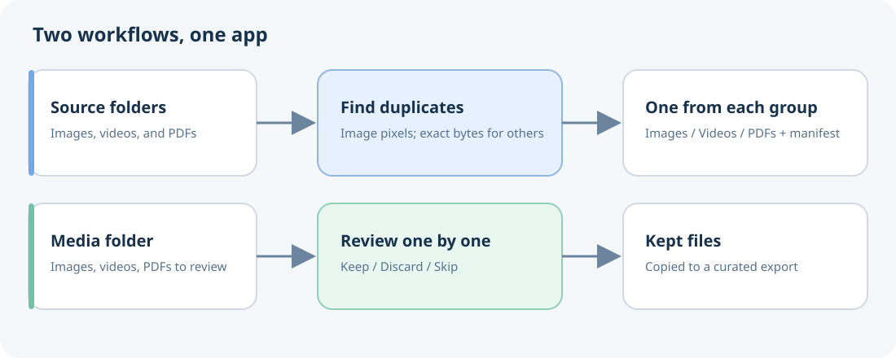
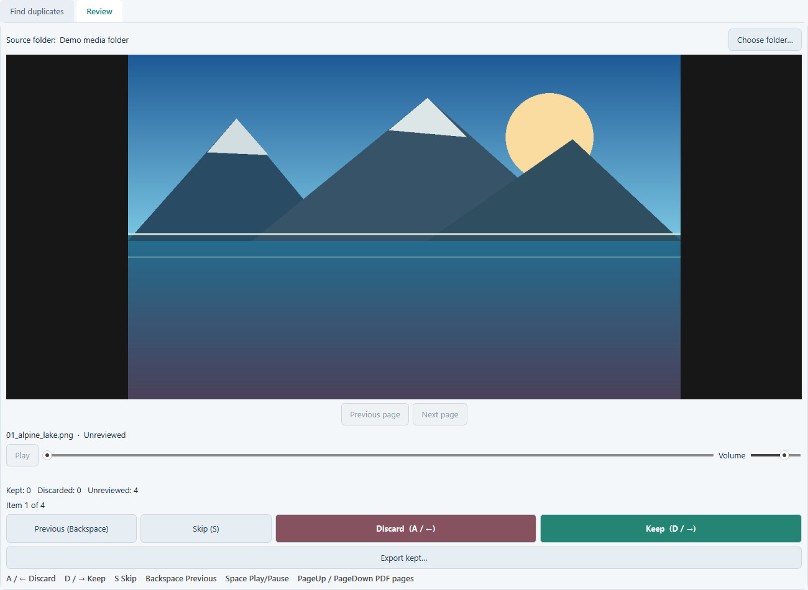

# MediaSift

MediaSift is a completely vibe-coded Windows desktop tool for finding exact duplicate images, videos, and PDF files, and for reviewing media before export. It never deletes or edits source files.

Choose a workflow from the tabs: **Find duplicates** compares selected folders; **Review** lets you decide which media files to keep. Both workflows copy files into a new destination folder.

For example, add several old phone and cloud-backup folders, export one copy of each unique file, then use Review to quickly choose which photos, videos, and PDFs belong in your final collection.

## Download for Windows

The latest published Windows x64 release is [v0.1.0](https://github.com/PhilippKotek/MediaSift/releases/tag/v0.1.0). It predates the Review, video deduplication, and PDF features documented here. Until the next release, build the current `develop` branch with `build.ps1` as described in [CONTRIBUTING.md](CONTRIBUTING.md). The build creates a versioned Windows ZIP containing `MediaSift.exe` and its notices. The executable runs without a Python installation.

## Find duplicates across folders

1. Click **Add folder…** and select the folders to combine. Ctrl- or Shift-click to choose several folders in the same location; open the picker again for folders elsewhere.
2. Choose a destination outside the source folders, then click **Start scan**.
3. Review groups and click **Export results**.
4. The timestamped `MediaSift_YYYYMMDD_HHMMSS` folder contains `Images`, `Videos`, and `PDFs` subfolders plus `Manifest.txt`. The manifest lists selected roots, output-to-source mappings, omitted duplicate members, counts, issues, and cancellation status.

The export includes one representative per exact duplicate group. The representative is the file with the alphabetically first full path (case-insensitive, with a case-sensitive tie-break). Matching is exact: image files match by decoded pixels and dimensions after EXIF orientation; videos and PDFs match by exact file bytes. Visually similar images, re-encoded videos, and PDFs with different bytes remain separate.

## Review a folder

1. Open the **Review** tab and choose a folder. MediaSift scans it and its subfolders, then restores earlier decisions when files still match.
2. Mark each previewed image, video, or PDF **Keep**, **Discard**, or **Skip**. Discard is a review decision; it never removes a file. Browse PDF pages with the buttons or PageUp/PageDown; the decision applies to the whole PDF.
3. Click **Export kept…** to copy kept files into a timestamped `MediaSift_Review_…` folder.

Keyboard shortcuts work while the Review tab is active, except while typing in a text field:

| Key | Action |
| --- | --- |
| `A` or `←` | Discard current item |
| `D` or `→` | Keep current item |
| `S` | Skip to next item |
| `Backspace` | Previous item |
| `PageUp` / `PageDown` | Previous / next PDF page |
| `Space` | Play or pause video |

Review decisions and the last folder are stored in `%LOCALAPPDATA%\MediaSift\review.sqlite3`. Decisions are reset if a file's size or modification time changes. MediaSift caches scan fingerprints for faster later scans; use **Full rescan** to rebuild the cache from files. Video preview uses Qt Multimedia. If playback fails because the format or codec is unavailable, use **Open in default app**.

## Supported files

- **Images:** JPG/JPEG, PNG, WebP, BMP, TIF, and TIFF. Files match only when decoded pixels and dimensions are equal, after applying EXIF orientation. Metadata and filenames do not affect matching. Animated or multi-frame files may be reported as issues in Find duplicates.
- **Videos:** MP4, MOV, M4V, AVI, MKV, WebM, and WMV. Exact byte matches are grouped.
- **PDFs:** PDF files are compared by exact bytes. A metadata change or different encoding means the files do not match, even when pages look the same.
- GIF files are excluded from both workflows.

## Safe output

Exports copy files into a new timestamped folder and never delete or edit originals. Choose a destination outside the source folders. Colliding filenames receive a suffix such as `_2`. Find duplicates scans and exports can be canceled; a canceled export retains its completed copies and records its status in the manifest. Files changed since scanning are skipped and reported.

## License

[MIT](LICENSE). Bundled third-party components and license references are listed in [THIRD_PARTY_NOTICES.md](THIRD_PARTY_NOTICES.md).
When sharing a built Windows executable, keep `THIRD_PARTY_NOTICES.md` and `PDFium_Licenses/` beside it.
